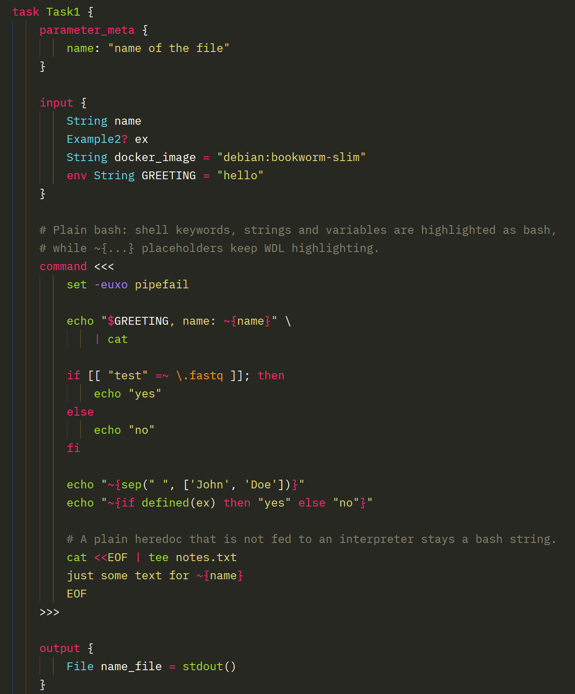
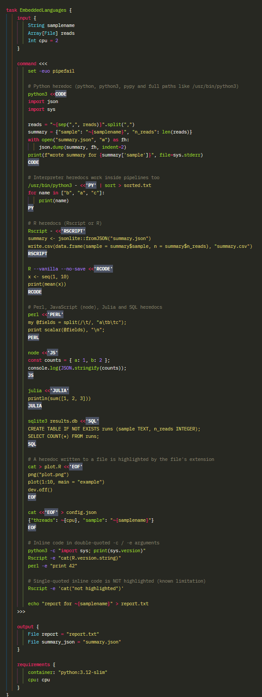

WDL extension for Zed
=====================

This extension provides support for the [Workflow Description Language (WDL)](https://openwdl.org/) in the [Zed](https://zed.dev) code editor. It supports WDL 1.0 through 1.3, using a fork of the [St. Jude tree-sitter grammar](https://github.com/sage-wright/tree-sitter-wdl) that includes WDL 1.0 command fixes, and the [Sprocket](https://github.com/stjude-rust-labs/sprocket) language server.

## Features

* Syntax highlighting for WDL
* Highlighting of embedded languages in `command` blocks:
  * Bash for the command block itself, with `~{...}` placeholders keeping WDL highlighting
  * Heredocs fed to an interpreter are highlighted in that interpreter's language:

    | Command | Language |
    |---|---|
    | `python`, `python3`, `pypy` (including full paths like `/usr/bin/python3`) | Python |
    | `R`, `Rscript` | R |
    | `perl` | Perl |
    | `ruby` | Ruby |
    | `node`, `nodejs` | JavaScript |
    | `julia` | Julia |
    | `sqlite3`, `psql`, `duckdb`, `mysql` | SQL |

  * Heredocs written to a file use the file's extension: `cat > plot.R <<'EOF'` is highlighted as R,
    `cat <<EOF > config.json` as JSON
  * Inline code in double-quoted `-c` / `-e` arguments, e.g. `python3 -c "..."`, `Rscript -e "..."`
* Document outline (workflows, tasks, structs, enums and calls) and breadcrumbs
* Automatic indentation
* Automatic closing of brackets and quotes
* Diagnostics from the Sprocket language server, with configurable linting and filtering
* Optional [ShellCheck](https://www.shellcheck.net/) diagnostics for the bash in `command` blocks, and
  [Ruff](https://docs.astral.sh/ruff/) diagnostics for the Python heredocs inside them
* Support for `~{sep=...}`, `~{default=...}`, and `~{true=... false=....}`, and bash `~${...}` highlighted as bash inside `<<< >>>` commands

## Previews




## Requirements

* **[Sprocket](https://github.com/stjude-rust-labs/sprocket)** on your `PATH`:
  `brew install sprocket` or `cargo install sprocket --locked`.
  For remote development (SSH), install it on the remote machine, where Zed runs language servers.
* **`python3`**, only if you hide diagnostics with `type_mismatches: false` or `hide_diagnostics`
  (see [Configuration](#configuration)).
* **`python3`** on your `PATH` for the `wdl-command-lint` language server to start, even while it is
  turned off (it then reports nothing). If you don't have `python3`, hide the server as described in
  [Linting command blocks](#linting-command-blocks). ShellCheck and Ruff themselves are downloaded
  automatically when you turn them on, unless they are already on your `PATH`.
* **Language extensions for embedded code.** Python and JavaScript are built into Zed. R, Perl,
  Ruby, Julia and SQL highlighting needs the corresponding Zed extension; without it, that code is
  shown as a bash string.

## Configuration

Settings go under `lsp.sprocket.settings`, either in your Zed user settings or in a project's
`.zed/settings.json`. Project settings also apply when the project is opened over SSH, and let you
share one configuration with everyone working on a repository.

```json
{
  "lsp": {
    "sprocket": {
      "settings": {
        "lint": false,
        "warnings": false,
        "type_mismatches": true,
        "except": [],
        "hide_diagnostics": ""
      }
    }
  }
}
```

| Setting | Type | Default | Effect |
|---|---|---|---|
| `lint` | boolean | `false` | Enables Sprocket's lint rules (`sprocket analyzer --lint`). |
| `warnings` | boolean | `false` | Shows Sprocket's warning-level analysis rules: `UnusedImport`, `UnusedInput`, `UnusedDeclaration`, `UnusedCall`, `UnnecessaryFunctionCall`, `UsingFallbackVersion`. |
| `type_mismatches` | boolean | `true` | Set to `false` to hide Sprocket's `type mismatch: ...` errors. Requires `python3`. |
| `except` | array of strings | `[]` | Additional Sprocket rule IDs to disable. Run `sprocket explain` for the list; Sprocket will not start if a name is unknown. |
| `hide_diagnostics` | string (regex) | `""` | Hides any diagnostic whose message matches this regular expression. Requires `python3`. |

Run `editor: restart language server` after changing these settings.

### Overriding the Sprocket command

`lsp.sprocket.binary` sets a specific `sprocket` executable and/or its arguments:

```json
{
  "lsp": {
    "sprocket": {
      "binary": {
        "path": "/opt/sprocket/bin/sprocket",
        "arguments": ["analyzer", "--stdio", "--lint"]
      }
    }
  }
}
```

`arguments` replaces the arguments generated from `lint`, `warnings` and `except`.
`type_mismatches` and `hide_diagnostics` still apply.

### Sprocket config files

Sprocket also reads `sprocket.toml` from the project root and from `~/.config/sprocket/sprocket.toml`.
These can only *add* to the extension's settings. For example, `[analyzer] lint = true` turns on
linting for a repository, and `except = [...]` disables more rules. They cannot re-enable warnings
the extension has turned off, and they cannot hide type mismatches.

### Skipping files

To exclude files or directories from analysis (vendored workflows, test fixtures, `draft-2` files),
list them in a `.sprocketignore` file at the project root, using `.gitignore` syntax.

### Linting command blocks

The extension includes a second language server, `wdl-command-lint`, that runs
[ShellCheck](https://www.shellcheck.net/) on the bash in each `command` block and
[Ruff](https://docs.astral.sh/ruff/) on the Python heredocs inside them, and shows their warnings
next to Sprocket's. Both are off by default. (Zed only uses embedded languages for highlighting, so a
bash or Python extension's language server never sees the code inside a WDL file; this server fills
that gap.) To turn them on:

```json
{
  "lsp": {
    "wdl-command-lint": {
      "settings": {
        "check_for_updates": true,
        "shellcheck": {
          "enabled": true,
          "exclude": ["SC2164"],
          "severity": "warning"
        },
        "ruff": {
          "enabled": true,
          "ignore": ["E722"]
        }
      }
    }
  }
}
```

| Setting | Type | Default | Effect |
|---|---|---|---|
| `check_for_updates` | boolean | `true` | Checks GitHub for a newer ShellCheck or Ruff each time the server starts. Set to `false` to keep using the downloaded copy. Only applies to copies the extension downloaded. |
| `shellcheck.enabled` | boolean | `false` | Runs ShellCheck on command blocks. |
| `shellcheck.path` | string | | A specific `shellcheck` executable. |
| `shellcheck.exclude` | array of strings | `[]` | ShellCheck codes to ignore, e.g. `["SC2086", "SC2164"]`. |
| `shellcheck.severity` | string | `"style"` | Lowest level to show: `error`, `warning`, `info` or `style`. |
| `ruff.enabled` | boolean | `false` | Runs Ruff on Python heredocs. |
| `ruff.path` | string | | A specific `ruff` executable. |
| `ruff.ignore` | array of strings | `[]` | Ruff rule codes to ignore, e.g. `["E722"]`. |

Each tool is found in this order: its `path` setting, then your `PATH`, then a copy the extension
downloads from the tool's GitHub releases ([ShellCheck](https://github.com/koalaman/shellcheck/releases),
[Ruff](https://github.com/astral-sh/ruff/releases)) into its working directory. If GitHub can't be
reached, an already-downloaded copy is used. Run `editor: restart language server` after changing
these settings.

ShellCheck reads a `.shellcheckrc` from the WDL file's directory or its parents, and
`# shellcheck disable=SC2086` comments work inside a command block. Ruff reads `pyproject.toml` or
`ruff.toml` the same way, and `# noqa: F401` comments work inside a heredoc.

Before linting, the extension removes the command block's common indentation (as WDL does) and
replaces each WDL placeholder with code of the same length, so placeholders don't trigger quoting or
constant-expression warnings. In `command { }` blocks, `${...}` is a WDL placeholder too. Each command
block is checked as its own script, and a syntax error stops ShellCheck from reporting anything else
in that block.

Heredoc bodies are data to bash, so ShellCheck only checks the `$var`, `$(...)` and backtick
expansions in heredocs with an unquoted delimiter (`<<EOF`), and nothing in heredocs with a quoted
one (`<<'EOF'`). Ruff checks a heredoc as Python when it is fed to `python`/`pypy` with only flags as
arguments (`python3 <<CODE`, `python3 -u - <<CODE`) or written to a `.py` file (`cat > x.py <<EOF`).
Ruff sees the code as written, without bash's `$` and `\` processing in unquoted heredocs. Python in
`python3 -c "..."`, in `env python3 <<EOF` or piped into `python3`, and code in other languages (R,
Perl, and so on) are not linted.

To hide the server entirely, add `"languages": { "WDL": { "language_servers": ["...", "!wdl-command-lint"] } }`
to your settings.

### Marking embedded-language blocks

The opening and closing delimiters of heredocs that contain another language (the `CODE` in
`python3 <<CODE ... CODE`) carry the highlight name `embedded.delimiter`. Themes don't style it, so
it looks like a normal heredoc delimiter until you give it a style in your Zed settings:

```json
{
  "experimental.theme_overrides": {
    "syntax": {
      "embedded.delimiter": {
        "background_color": "#4b5263",
        "font_weight": 700
      }
    }
  }
}
```

## Limitations

* Code in single-quoted `-c` / `-e` arguments (e.g. `Rscript -e '...'`) is not highlighted, because
  bash parses the quoted text and its quotes as one token.
* Interpreters are detected by command name, so `env python3 <<EOF` or `uv run python <<EOF` are not
  recognized.
* WDL placeholders inside embedded code are passed to that language's parser as-is. `~{x}` happens to
  be valid Python, but other languages, such as R, may show small local highlighting errors around it.
* In `command { }` blocks, an unescaped `}` ends the block, as defined by WDL. Use `command <<< >>>`
  or escape it as `\}`.

## Development

1. Install Rust with [rustup](https://rustup.rs) (on Windows, accept the Visual Studio C++ build
   tools when the installer offers them), then add the WebAssembly target:
   `rustup target add wasm32-wasip2`.
2. Uninstall the published WDL extension, if installed.
3. In Zed, run `zed: install dev extension` and select this repository's folder. It must be a folder
   on the machine running Zed's interface, even if you edit files on a remote machine.
4. After changing files, click **Rebuild** on the extension in `zed: extensions`.
   Errors appear in `zed: open log`.

`cargo build --release --target wasm32-wasip2` reproduces Zed's build of the Rust code from a
terminal.

## Related repositories

* [stjude-rust-labs/tree-sitter-wdl](https://github.com/stjude-rust-labs/tree-sitter-wdl): Tree-sitter grammar for WDL
* [stjude-rust-labs/sprocket](https://github.com/stjude-rust-labs/sprocket): WDL language server and toolkit
* [Zed](https://github.com/zed-industries/zed): the bash highlight query in
  `languages/wdl-shell/highlights.scm` comes from Zed and is licensed GPL-3.0-or-later
  (see `licenses/zed-LICENSE-GPL`)
